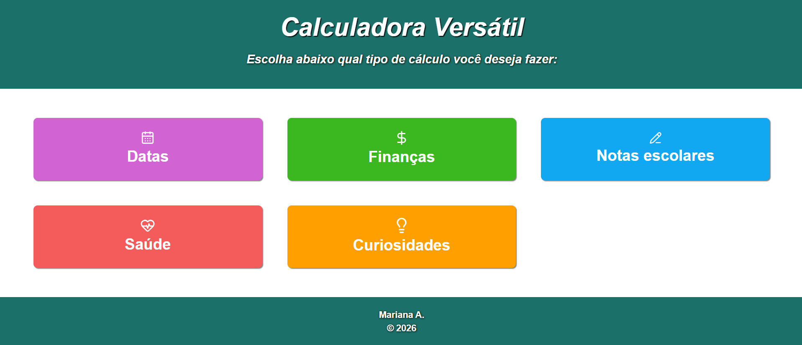

# Calculadora Versátil 

## 📌 Descrição

Desenvolvi este site com o objetivo de facilitar cálculos do dia a dia, sem a necessidade de pesquisar fórmulas, variáveis ou perder tempo com contas mais trabalhosas.

O site reúne diferentes tipos de cálculos de diversas áreas, tornando o processo mais rápido, prático e acessível.

## 🧮 Funcionalidades

O site permite realizar cálculos rápidos e práticos nas seguintes áreas:

* **Datas:** aniversários, diferença de idade e outros cálculos relacionados a datas.
* **Finanças:** juros simples e compostos, aumentos e outros cálculos financeiros.
* **Notas escolares:** índice de aproveitamento e outros cálculos relacionados ao desempenho escolar.
* **Saúde:** IMC, RCQ (Relação Cintura-Quadril) e outros indicadores.
* **Curiosidades:** cálculos relacionados a altura, velocidade e outros temas.

## 💻 Tecnologias

* HTML
* CSS
* JavaScript
* Ícones do site Lucide (https://lucide.dev/icons/)

## 🔄 Atualizações

O site base está desenvolvido, mas podem haver atualizações com novos cálculos, áreas e correções de bugs.

## 🌐 Acesso

Para acessar o site em funcionamento, basta clicar no link abaixo:

https://anamarih732.github.io/Calculos/
